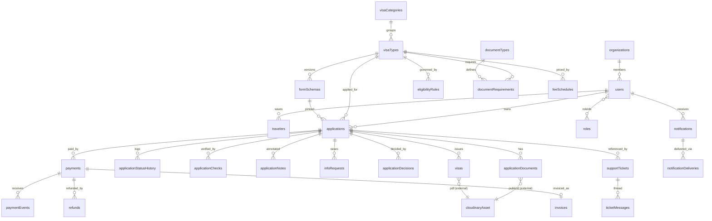

# Backend Database Schema (MongoDB + Mongoose)

**Product:** VisaGate — Online Visa Application & Tracking Portal *(working name)*
**Document ID:** VG-DB-001
**Version:** 1.1 (MongoDB / MERN + Cloudinary)
**Date:** 18 October 2026
**Target DB:** MongoDB 7+ (Atlas replica set) with Mongoose 8
**Owner:** Backend / Data Architecture
**Related documents:** `1-PRD.md`, `2-TRD.md`, `3-UI-UX.md`

---

## Document Control

| Version | Date       | Author      | Description |
|---------|------------|-------------|-------------|
| 1.0     | 2026-10-17 | Data Arch.  | Initial baseline (PostgreSQL variant) |
| 1.1     | 2026-10-18 | Data Arch.  | Re-modeled for MongoDB/Mongoose; Cloudinary asset model added |

---

## 1. Overview and Conventions

### 1.1 Design Goals
- Model the core aggregate (**applications**) as a document with embedded, bounded children (travelers, fee snapshot), and keep unbounded or independently queried data in separate collections.
- Everything configurable (visa types, forms, eligibility, documents, fees) is **data**, versioned and effective-dated.
- Sensitive identifiers encrypted at the application layer and searchable through **blind indexes**.
- Immutable audit trail and transactional outbox for reliable events.
- Files live in **Cloudinary**; MongoDB stores only references and verified metadata.

### 1.2 Naming and Type Conventions

| Topic | Convention |
|-------|-----------|
| Collections | `camelCase`, plural (`applications`, `visaTypes`) |
| Fields | `camelCase` |
| Primary keys | `_id: ObjectId` (exposed as `id` string). Not secret — always enforce authorization |
| Timestamps | `createdAt`, `updatedAt` via Mongoose `timestamps: true` (UTC `Date`) |
| Soft delete | `deletedAt: Date` where legally allowed; on user deletion the e-mail is anonymized to free the unique index |
| Money | integer minor units (`Number`, safe integer range) + `currency` (ISO 4217) |
| Country / nationality | ISO 3166-1 alpha-2 strings referencing `countries.code` |
| Localized text | object `{ en: String, ar: String }` (`Mixed`/sub-schema) |
| Optimistic locking | Mongoose `optimisticConcurrency: true` (uses `__v`) on aggregates |
| Encrypted fields | `fieldEnc: Buffer` (AES-256-GCM envelope); blind index `fieldBidx: Buffer` (HMAC-SHA-256) |
| Enums | string unions defined once in `packages/shared`, enforced by Mongoose `enum` and `$jsonSchema` |
| Referential integrity | by convention (`ref`), checked in services; **no cascading deletes** — retention jobs delete children explicitly |

### 1.3 Embed vs. Reference Decisions

| Data | Decision | Reason |
|------|----------|--------|
| Application travelers (≤ 10) | **Embedded** in `applications` | Always loaded and saved with the application; atomic updates |
| Per-step answers | **Embedded** (`steps` map on the application and on each traveler) | Bounded by the form schema; single read for the wizard |
| Fee quote snapshot | **Embedded** (`feeQuote`) | Immutable at submission, read with the application |
| Documents | **Separate** `applicationDocuments` | Independent status, review workflow, queries |
| Status history, decisions, notes, checks, info requests | **Separate** collections | Unbounded/append-only; queried independently |
| Fee components | **Embedded** in `feeSchedules` | Small, always used together |
| Roles → permissions | Embedded array of permission codes | Small set; checked in memory |
| Ticket messages | **Separate** `ticketMessages` | Unbounded |
| Nationality group members | Embedded array (with validity dates) | Small, read as a whole |

### 1.4 Domain Map

| Domain | Collections |
|--------|-------------|
| Identity & access | `users`, `organizations`, `roles`, `sessions`, `otpCodes`, `consents`, `dataSubjectRequests` |
| Reference | `countries`, `nationalityGroups` |
| Catalog & rules | `visaCategories`, `visaTypes`, `formSchemas`, `eligibilityRules`, `documentTypes`, `documentRequirements`, `feeSchedules` |
| Applications | `travelers`, `applications`, `applicationDocuments`, `applicationStatusHistory`, `applicationChecks`, `applicationNotes`, `infoRequests`, `applicationDecisions` |
| Payments | `payments`, `paymentEvents`, `refunds`, `invoices` |
| Issuance | `visas` |
| Communication | `notificationTemplates`, `notifications`, `notificationDeliveries` |
| Content | `cmsPages`, `faqCategories`, `faqs`, `announcements` |
| Support | `supportTickets`, `ticketMessages` |
| Platform | `auditLogs`, `auditChainHeads`, `outboxEvents`, `idempotencyKeys`, `retentionPolicies`, `integrationAdapters`, `counters` |

---

## 2. Entity Relationship Diagram (References)



---

## 3. Enumerations (shared constants)

```ts
// packages/shared/src/enums.ts
export const USER_TYPE = ['APPLICANT','CORPORATE','STAFF','SERVICE'] as const;
export const USER_STATUS = ['PENDING_VERIFICATION','ACTIVE','LOCKED','SUSPENDED','DELETED'] as const;
export const APPLICATION_STATUS = ['DRAFT','PENDING_PAYMENT','SUBMITTED','UNDER_REVIEW','INFO_REQUESTED',
  'APPROVED','ISSUED','REJECTED','WITHDRAWN','EXPIRED','CANCELLED'] as const;
export const TRAVELER_DECISION = ['PENDING','APPROVED','REJECTED'] as const;
export const DECISION_TYPE = ['APPROVE','REJECT','REQUEST_INFO','ESCALATE'] as const;
export const DOCUMENT_STATUS = ['PENDING_UPLOAD','PENDING_SCAN','CLEAN','INFECTED','ACCEPTED','REJECTED','REMOVED'] as const;
export const CHECK_STATUS = ['QUEUED','RUNNING','PASS','FAIL','REVIEW','ERROR'] as const;
export const PAYMENT_STATUS = ['CREATED','REQUIRES_ACTION','PROCESSING','SUCCEEDED','FAILED','CANCELLED','REFUNDED','PARTIALLY_REFUNDED'] as const;
export const REFUND_STATUS = ['REQUESTED','APPROVED','REJECTED','PROCESSING','COMPLETED','FAILED'] as const;
export const FEE_KIND = ['VISA_FEE','SERVICE_FEE','INSURANCE','TAX','DISCOUNT','EXEMPTION'] as const;
export const RULE_EFFECT = ['ELIGIBLE','CONDITIONAL','NOT_ELIGIBLE'] as const;
export const SCHEMA_STATUS = ['DRAFT','IN_REVIEW','PUBLISHED','ARCHIVED'] as const;
export const CONTENT_STATUS = ['DRAFT','PUBLISHED','ARCHIVED'] as const;
export const CHANNEL = ['EMAIL','SMS','IN_APP','WHATSAPP'] as const;
export const DELIVERY_STATUS = ['QUEUED','SENT','DELIVERED','FAILED','BOUNCED','SUPPRESSED'] as const;
export const TICKET_STATUS = ['OPEN','PENDING_CUSTOMER','PENDING_AGENT','RESOLVED','CLOSED'] as const;
export const OTP_PURPOSE = ['EMAIL_VERIFY','PHONE_VERIFY','LOGIN','PASSWORD_RESET','TRACKING_STEPUP'] as const;
export const DSR_TYPE = ['EXPORT','DELETION','RECTIFICATION'] as const;
export const DSR_STATUS = ['RECEIVED','IN_PROGRESS','COMPLETED','REJECTED'] as const;
export const ENTRY_TYPE = ['SINGLE','MULTIPLE'] as const;
export const OUTBOX_STATUS = ['PENDING','PROCESSING','DONE','FAILED'] as const;
```

---

## 4. Collection Definitions (Mongoose)

> Snippets show the essential shape: fields, constraints and **indexes**. Every schema uses `{ timestamps: true, strict: 'throw' }` unless noted. In production `autoIndex` is **off**; indexes are created by `migrate-mongo` migrations (§11). `LocalizedText = { en: String, ar: String }`.

### 4.1 Identity and Access

```ts
// users — profile embedded
const UserSchema = new Schema({
  email:            { type: String, required: true, lowercase: true, trim: true },
  emailVerifiedAt:  Date,
  phoneE164:        String,
  phoneVerifiedAt:  Date,
  passwordHash:     String,                         // Argon2id; absent for SSO-only
  userType:         { type: String, enum: USER_TYPE, default: 'APPLICANT', required: true },
  status:           { type: String, enum: USER_STATUS, default: 'PENDING_VERIFICATION', required: true },
  locale:           { type: String, enum: ['en','ar'], default: 'en' },
  roleIds:          [{ type: ObjectId, ref: 'Role' }],          // staff roles
  roleScopes:       { type: Mixed, default: {} },               // {"visaCategories":["VISIT"],"queues":["A"]}
  organizationIds:  [{ type: ObjectId, ref: 'Organization' }],
  mfa:              { enabled: { type: Boolean, default: false }, secretEnc: Buffer, recoveryHashes: [Buffer] },
  failedLoginCount: { type: Number, default: 0 },
  lockedUntil:      Date,
  lastLoginAt:      Date,
  profile: {
    fullName: String, fullNameAr: String,
    dateOfBirthEnc: Buffer,
    gender: { type: String, enum: ['M','F','X'] },
    nationalityCode: String, residenceCountryCode: String,
    address: { type: Mixed, default: {} },
    preferences: { type: Mixed, default: {} }               // notification prefs, digits style
  },
  deletedAt: Date
}, { timestamps: true, optimisticConcurrency: true });
UserSchema.index({ email: 1 }, { unique: true });                       // anonymized on deletion
UserSchema.index({ phoneE164: 1 }, { unique: true, partialFilterExpression: { phoneE164: { $type: 'string' } } });
UserSchema.index({ userType: 1, status: 1 });
```

```ts
const OrganizationSchema = new Schema({
  legalName: { type: String, required: true },
  registrationNoEnc: Buffer, registrationNoBidx: Buffer,
  countryCode: String,
  status: { type: String, default: 'ACTIVE' },
  billing: { type: Mixed, default: {} },
  members: [{ userId: { type: ObjectId, ref: 'User' }, role: { type: String, enum: ['OWNER','ADMIN','MEMBER','VIEWER'] }, addedAt: Date }]
}, { timestamps: true });
OrganizationSchema.index({ registrationNoBidx: 1 }, { unique: true, partialFilterExpression: { registrationNoBidx: { $exists: true } } });
OrganizationSchema.index({ 'members.userId': 1 });

const RoleSchema = new Schema({
  code: { type: String, required: true },           // CASE_OFFICER, SUPERVISOR, ...
  name: LocalizedText,
  permissions: [String],                            // case:decide, fee:write, ...
  isSystem: { type: Boolean, default: false }
}, { timestamps: true });
RoleSchema.index({ code: 1 }, { unique: true });

const SessionSchema = new Schema({                  // refresh-token sessions
  userId: { type: ObjectId, ref: 'User', required: true },
  refreshHash: { type: Buffer, required: true },
  familyId: { type: ObjectId, required: true },     // rotation family for reuse detection
  userAgent: String, ip: String,
  lastUsedAt: Date,
  expiresAt: { type: Date, required: true },
  revokedAt: Date, revokeReason: String
}, { timestamps: true });
SessionSchema.index({ userId: 1, revokedAt: 1 });
SessionSchema.index({ familyId: 1 });
SessionSchema.index({ expiresAt: 1 }, { expireAfterSeconds: 60 * 60 * 24 * 30 });   // TTL: 30 days after expiry

const OtpCodeSchema = new Schema({
  userId: ObjectId,
  destinationHash: { type: Buffer, required: true },   // HMAC of email/phone
  purpose: { type: String, enum: OTP_PURPOSE, required: true },
  codeHash: { type: Buffer, required: true },
  attempts: { type: Number, default: 0 },
  expiresAt: { type: Date, required: true },
  consumedAt: Date
}, { timestamps: true });
OtpCodeSchema.index({ destinationHash: 1, purpose: 1, createdAt: -1 });
OtpCodeSchema.index({ expiresAt: 1 }, { expireAfterSeconds: 86400 });                // TTL

const ConsentSchema = new Schema({
  userId: ObjectId, applicationId: ObjectId,
  consentCode: { type: String, required: true },       // TERMS, PRIVACY, DECLARATION_TRUTH, MARKETING, COOKIES_ANALYTICS
  documentVersion: { type: String, required: true },
  granted: { type: Boolean, required: true },
  ip: String, userAgent: String
}, { timestamps: { createdAt: true, updatedAt: false } });
ConsentSchema.index({ userId: 1, consentCode: 1, createdAt: -1 });

const DataSubjectRequestSchema = new Schema({
  userId: { type: ObjectId, required: true },
  type: { type: String, enum: DSR_TYPE, required: true },
  status: { type: String, enum: DSR_STATUS, default: 'RECEIVED' },
  details: { type: Mixed, default: {} },
  dueAt: { type: Date, required: true }, completedAt: Date, handledBy: ObjectId
}, { timestamps: true });
DataSubjectRequestSchema.index({ status: 1, dueAt: 1 });
```

### 4.2 Reference Data

```ts
const CountrySchema = new Schema({
  code: { type: String, required: true },            // ISO alpha-2
  alpha3: { type: String, required: true },
  names: LocalizedText, nationalityNames: LocalizedText,
  dialCode: String, isActive: { type: Boolean, default: true }, sortOrder: Number
});
CountrySchema.index({ code: 1 }, { unique: true });

const NationalityGroupSchema = new Schema({
  code: { type: String, required: true },            // GROUP_A, GROUP_B, GCC, VISA_EXEMPT
  name: LocalizedText, description: LocalizedText,
  members: [{ countryCode: String, validFrom: Date, validTo: Date }]
}, { timestamps: true });
NationalityGroupSchema.index({ code: 1 }, { unique: true });
NationalityGroupSchema.index({ 'members.countryCode': 1 });
```

### 4.3 Catalog and Rules

```ts
const VisaCategorySchema = new Schema({
  code: { type: String, required: true },            // VISIT, TRANSIT, WORK, RESIDENCE, STUDY, SPECIAL, SERVICES
  name: LocalizedText, description: LocalizedText, icon: String,
  sortOrder: { type: Number, default: 0 }, isActive: { type: Boolean, default: true }
});
VisaCategorySchema.index({ code: 1 }, { unique: true });

const VisaTypeSchema = new Schema({
  categoryId: { type: ObjectId, ref: 'VisaCategory', required: true },
  code: { type: String, required: true },            // TOURIST_SINGLE, BUSINESS, FAMILY_VISIT, ...
  slug: { type: String, required: true },
  name: LocalizedText, summary: LocalizedText, description: Mixed,   // rich-text blocks per locale
  entryType: { type: String, enum: ENTRY_TYPE, required: true },
  validityDays: { type: Number, required: true },
  maxStayDays: { type: Number, required: true },
  minPassportValidityMonths: { type: Number, default: 6 },
  minAge: Number,
  processingSlaHours: { type: Number, required: true },
  allowsMultiTraveler: { type: Boolean, default: true },
  maxTravelers: { type: Number, default: 10, max: 10 },
  requiresSponsor: { type: Boolean, default: false },
  requiresPayment: { type: Boolean, default: true },
  draftExpiryDays: { type: Number, default: 30 },
  infoRequestDays: { type: Number, default: 7 },
  pendingPaymentHours: { type: Number, default: 48 },
  onInfoTimeout: { type: String, enum: ['EXPIRE','REJECT'], default: 'EXPIRE' },
  purposes: [String],                                // finder purposes: TOURISM, BUSINESS, FAMILY, MEDICAL
  seo: { type: Mixed, default: {} },
  searchText: String,                                // normalized ar+en text for search
  isActive: { type: Boolean, default: false }, sortOrder: { type: Number, default: 0 }
}, { timestamps: true });
VisaTypeSchema.index({ code: 1 }, { unique: true });
VisaTypeSchema.index({ slug: 1 }, { unique: true });
VisaTypeSchema.index({ categoryId: 1, isActive: 1, sortOrder: 1 });
VisaTypeSchema.index({ purposes: 1, isActive: 1 });

const FormSchemaSchema = new Schema({
  visaTypeId: { type: ObjectId, ref: 'VisaType', required: true },
  version: { type: Number, required: true },
  status: { type: String, enum: SCHEMA_STATUS, default: 'DRAFT' },
  schema: { type: Mixed, required: true },           // see §5.1
  changeNote: String, createdBy: ObjectId,
  approvedBy: ObjectId,                              // maker-checker (must differ from createdBy)
  publishedAt: Date
}, { timestamps: true });
FormSchemaSchema.index({ visaTypeId: 1, version: 1 }, { unique: true });
FormSchemaSchema.index({ visaTypeId: 1 }, { unique: true, partialFilterExpression: { status: 'PUBLISHED' } }); // one published version

const EligibilityRuleSchema = new Schema({
  visaTypeId: { type: ObjectId, ref: 'VisaType', required: true },
  name: String, priority: { type: Number, default: 100 },
  condition: { type: Mixed, required: true },        // JSON-Logic, see §5.2
  effect: { type: String, enum: RULE_EFFECT, required: true },
  reason: LocalizedText, conditionsText: LocalizedText,
  channel: { type: String, enum: ['E_VISA','ON_ARRIVAL','EMBASSY'], default: 'E_VISA' },
  effectiveFrom: { type: Date, default: Date.now }, effectiveTo: Date,
  isActive: { type: Boolean, default: true },
  updatedBy: ObjectId
}, { timestamps: true, optimisticConcurrency: true });
EligibilityRuleSchema.index({ visaTypeId: 1, isActive: 1, priority: 1 });

const DocumentTypeSchema = new Schema({
  code: { type: String, required: true },            // PASSPORT_BIO, PHOTO, HOTEL_BOOKING, ...
  name: LocalizedText, instructions: LocalizedText,
  allowedMime: { type: [String], default: ['application/pdf','image/jpeg','image/png'] },
  allowedFormats: { type: [String], default: ['pdf','jpg','png'] },     // Cloudinary formats
  maxSizeBytes: { type: Number, default: 5 * 1024 * 1024 },
  isPhoto: { type: Boolean, default: false }, isActive: { type: Boolean, default: true }
});
DocumentTypeSchema.index({ code: 1 }, { unique: true });

const DocumentRequirementSchema = new Schema({
  visaTypeId: { type: ObjectId, ref: 'VisaType', required: true },
  documentTypeId: { type: ObjectId, ref: 'DocumentType', required: true },
  isRequired: { type: Boolean, default: true },
  condition: Mixed,                                  // null = always; JSON-Logic otherwise
  perTraveler: { type: Boolean, default: true }, sortOrder: Number,
  effectiveFrom: { type: Date, default: Date.now }, effectiveTo: Date
}, { timestamps: true });
DocumentRequirementSchema.index({ visaTypeId: 1, documentTypeId: 1, effectiveFrom: 1 }, { unique: true });

const FeeScheduleSchema = new Schema({
  visaTypeId: { type: ObjectId, ref: 'VisaType', required: true },
  name: String, currency: { type: String, default: 'SAR' },
  condition: Mixed,                                  // optional applicability (nationality group, age)
  priority: { type: Number, default: 100 },
  effectiveFrom: { type: Date, required: true }, effectiveTo: Date,
  components: [{
    kind: { type: String, enum: FEE_KIND, required: true },
    code: { type: String, required: true },          // VISA_FEE, DIGITAL_SERVICE, VAT, INSURANCE_STD
    label: LocalizedText,
    amountMinor: Number,                             // fixed amount OR
    percentBp: Number,                               // basis points of a base (1500 = 15%)
    appliesTo: { type: String, enum: ['PER_TRAVELER','PER_APPLICATION'], default: 'PER_TRAVELER' },
    baseCodes: [String], isOptional: Boolean, isRefundable: Boolean, condition: Mixed, sortOrder: Number
  }],
  approvedBy: ObjectId, createdBy: ObjectId
}, { timestamps: true });
FeeScheduleSchema.index({ visaTypeId: 1, priority: 1, effectiveFrom: -1 });
// Overlap (same visaType + priority + overlapping dates) is rejected by the publish service inside a transaction.
// Each component must define exactly one of amountMinor / percentBp (Mongoose validator + $jsonSchema).
```

### 4.4 Applications

```ts
const TravelerSchema = new Schema({                   // saved traveler address book
  ownerUserId: { type: ObjectId, ref: 'User', required: true },
  label: String, givenNames: { type: String, required: true }, surname: { type: String, required: true },
  fullNameAr: String, dateOfBirthEnc: { type: Buffer, required: true },
  gender: { type: String, enum: ['M','F','X'] }, nationalityCode: { type: String, required: true },
  passportNoEnc: Buffer, passportNoBidx: Buffer,
  passportIssueDate: Date, passportExpiryDate: Date, passportCountry: String,
  extra: { type: Mixed, default: {} }, deletedAt: Date
}, { timestamps: true });
TravelerSchema.index({ ownerUserId: 1, deletedAt: 1 });

// Embedded in applications
const ApplicationTravelerSchema = new Schema({
  travelerId: ObjectId,                               // source address-book entry (optional)
  position: { type: Number, required: true },
  isPrimary: Boolean,
  givenNames: String, surname: String, fullNameAr: String,
  dateOfBirthEnc: Buffer, gender: String, nationalityCode: String,
  passportNoEnc: Buffer, passportNoBidx: Buffer,      // blind index → tracking & duplicate checks
  passportIssueDate: Date, passportExpiryDate: Date, passportCountry: String,
  nationalIdEnc: Buffer, nationalIdBidx: Buffer,
  steps: { type: Mixed, default: {} },                // { stepKey: { data, isComplete, validatedAt } }
  completionPct: { type: Number, min: 0, max: 100, default: 0 },
  decision: { type: String, enum: TRAVELER_DECISION, default: 'PENDING' },
  decisionReasonCode: String
});   // _id retained: used as travelerId in Cloudinary folders and documents

const ApplicationSchema = new Schema({
  reference: String,                                  // VG-XXXX-XXXX-XXXX (random, check digit)
  applicantUserId: { type: ObjectId, ref: 'User', required: true },
  organizationId: ObjectId,
  visaTypeId: { type: ObjectId, ref: 'VisaType', required: true },
  formSchemaId: { type: ObjectId, ref: 'FormSchema', required: true },     // pinned version
  status: { type: String, enum: APPLICATION_STATUS, default: 'DRAFT', required: true },
  locale: { type: String, default: 'en' },
  travelPurpose: String,
  intendedArrival: Date, intendedDeparture: Date,
  entryChannel: { type: String, enum: ['E_VISA','ON_ARRIVAL','EMBASSY'] },
  steps: { type: Mixed, default: {} },                // application-level step answers
  travelers: { type: [ApplicationTravelerSchema], validate: v => v.length >= 1 && v.length <= 10 },
  feeQuote: {                                         // immutable snapshot at submission
    feeScheduleId: ObjectId, currency: String,
    lines: [{ code: String, kind: String, label: LocalizedText, qty: Number, unitMinor: Number, amountMinor: Number, percentBp: Number }],
    subtotalMinor: Number, taxMinor: Number, discountMinor: Number, totalMinor: Number,
    rulesVersion: String, isFinal: Boolean, expiresAt: Date, quotedAt: Date
  },
  slaDueAt: Date,
  assignedTo: ObjectId,
  priority: { type: Number, default: 0 },
  source: { type: String, default: 'WEB' },           // WEB, API, BULK, STAFF
  clonedFromId: ObjectId,
  submittedAt: Date, decidedAt: Date,
  expiresAt: Date                                      // current deadline: draft / pending payment / info request
}, { timestamps: true, optimisticConcurrency: true });
ApplicationSchema.index({ reference: 1 }, { unique: true, partialFilterExpression: { reference: { $type: 'string' } } });
ApplicationSchema.index({ applicantUserId: 1, updatedAt: -1 });
ApplicationSchema.index({ status: 1, slaDueAt: 1 });                         // officer queue
ApplicationSchema.index({ assignedTo: 1, status: 1 });
ApplicationSchema.index({ visaTypeId: 1, status: 1, submittedAt: -1 });
ApplicationSchema.index({ expiresAt: 1, status: 1 });                        // expiry sweeps
ApplicationSchema.index({ organizationId: 1, createdAt: -1 });
ApplicationSchema.index({ 'travelers.passportNoBidx': 1, visaTypeId: 1 });  // tracking + duplicate detection
ApplicationSchema.index({ 'travelers.nationalIdBidx': 1 });
```
`$jsonSchema` validator (applied with `collMod`, `validationLevel: "strict"`) additionally enforces: `status` enum, `travelers` array size 1–10, `feeQuote.totalMinor >= 0`, `intendedDeparture >= intendedArrival` (checked in Mongoose pre-validate as well).

```ts
const ApplicationDocumentSchema = new Schema({
  applicationId: { type: ObjectId, ref: 'Application', required: true },
  travelerId: ObjectId,                               // embedded traveler _id (null = application-level)
  documentTypeId: { type: ObjectId, ref: 'DocumentType', required: true },
  infoRequestId: ObjectId, infoRequestItemId: ObjectId,
  status: { type: String, enum: DOCUMENT_STATUS, default: 'PENDING_UPLOAD' },
  cloudinary: {                                       // see §13 — verified by server via Admin API
    publicId: String, assetId: String,
    resourceType: { type: String, enum: ['image','raw','video'] },
    deliveryType: { type: String, enum: ['authenticated'], default: 'authenticated' },
    version: Number, format: String, bytes: Number,
    width: Number, height: Number, pages: Number, etag: String,
    folder: String, uploadedAt: Date
  },
  originalFilenameEnc: Buffer,                        // optional display name, encrypted
  mimeType: String,
  scan: { engine: String, verdict: { type: String, enum: ['CLEAN','INFECTED','ERROR'] }, details: Mixed, scannedAt: Date },
  rejectionCode: String, rejectionNote: String,
  reviewedBy: ObjectId, reviewedAt: Date,
  uploadedBy: { type: ObjectId, required: true },
  removedAt: Date
}, { timestamps: true });
ApplicationDocumentSchema.index({ applicationId: 1, removedAt: 1 });
ApplicationDocumentSchema.index({ 'cloudinary.publicId': 1 }, { unique: true, partialFilterExpression: { 'cloudinary.publicId': { $type: 'string' } } });
ApplicationDocumentSchema.index({ status: 1, createdAt: 1 });                // scan worker sweeps

const ApplicationStatusHistorySchema = new Schema({     // append-only
  applicationId: { type: ObjectId, required: true },
  fromStatus: String, toStatus: { type: String, enum: APPLICATION_STATUS, required: true },
  actorUserId: ObjectId, actorType: { type: String, enum: ['USER','STAFF','SYSTEM'], default: 'USER' },
  reasonCode: String, note: String, metadata: { type: Mixed, default: {} }
}, { timestamps: { createdAt: true, updatedAt: false } });
ApplicationStatusHistorySchema.index({ applicationId: 1, createdAt: 1 });

const ApplicationCheckSchema = new Schema({
  applicationId: { type: ObjectId, required: true }, travelerId: ObjectId,
  adapterCode: { type: String, required: true },       // WATCHLIST, SPONSOR_REGISTRY, DUPLICATE, PASSPORT_RULES
  status: { type: String, enum: CHECK_STATUS, default: 'QUEUED' },
  score: Number, details: Mixed, externalRef: String,
  attempts: { type: Number, default: 0 }, nextAttemptAt: Date, startedAt: Date, finishedAt: Date
}, { timestamps: true });
ApplicationCheckSchema.index({ applicationId: 1 });
ApplicationCheckSchema.index({ status: 1, nextAttemptAt: 1 });

const ApplicationNoteSchema = new Schema({
  applicationId: { type: ObjectId, required: true }, authorId: { type: ObjectId, required: true },
  body: { type: String, required: true }, isInternal: { type: Boolean, default: true }
}, { timestamps: { createdAt: true, updatedAt: false } });
ApplicationNoteSchema.index({ applicationId: 1, createdAt: 1 });

const InfoRequestSchema = new Schema({
  applicationId: { type: ObjectId, required: true }, requestedBy: { type: ObjectId, required: true },
  message: LocalizedText, dueAt: { type: Date, required: true }, respondedAt: Date,
  status: { type: String, enum: ['OPEN','RESPONDED','EXPIRED','CANCELLED'], default: 'OPEN' },
  items: [{
    kind: { type: String, enum: ['DOCUMENT','FIELD','CLARIFICATION'], required: true },
    documentTypeId: ObjectId, stepKey: String, fieldKey: String,
    prompt: LocalizedText, response: Mixed, satisfiedAt: Date
  }]
}, { timestamps: true });
InfoRequestSchema.index({ applicationId: 1, status: 1 });
InfoRequestSchema.index({ status: 1, dueAt: 1 });

const ApplicationDecisionSchema = new Schema({         // append-only
  applicationId: { type: ObjectId, required: true }, travelerId: ObjectId,
  decision: { type: String, enum: DECISION_TYPE, required: true },
  reasonCode: { type: String, required: true }, reasonText: LocalizedText, internalNote: String,
  decidedBy: { type: ObjectId, required: true },
  secondApprover: ObjectId                              // four-eyes for escalated cases
}, { timestamps: { createdAt: true, updatedAt: false } });
ApplicationDecisionSchema.index({ applicationId: 1, createdAt: 1 });
```

### 4.5 Payments

```ts
const PaymentSchema = new Schema({
  applicationId: { type: ObjectId, ref: 'Application', required: true },
  provider: { type: String, required: true }, providerRef: String, method: String,
  status: { type: String, enum: PAYMENT_STATUS, default: 'CREATED' },
  amountMinor: { type: Number, required: true, min: 0 },
  currency: { type: String, required: true },
  refundedMinor: { type: Number, default: 0, min: 0 },          // validator: <= amountMinor, never decreases
  failureCode: String, failureMessage: String, payerIp: String,
  idempotencyKey: String, paidAt: Date
}, { timestamps: true, optimisticConcurrency: true });
PaymentSchema.index({ provider: 1, providerRef: 1 }, { unique: true, partialFilterExpression: { providerRef: { $type: 'string' } } });
PaymentSchema.index({ applicationId: 1, idempotencyKey: 1 }, { unique: true, partialFilterExpression: { idempotencyKey: { $type: 'string' } } });
PaymentSchema.index({ applicationId: 1, createdAt: -1 });
PaymentSchema.index({ status: 1, createdAt: 1 });

const PaymentEventSchema = new Schema({                // raw, replay-safe PSP webhook log (append-only)
  paymentId: ObjectId, provider: { type: String, required: true },
  providerEventId: { type: String, required: true }, eventType: String,
  payload: Mixed,                                       // sanitized: never PAN/CVV
  signatureValid: Boolean, processedAt: Date
}, { timestamps: { createdAt: 'receivedAt', updatedAt: false } });
PaymentEventSchema.index({ provider: 1, providerEventId: 1 }, { unique: true });

const RefundSchema = new Schema({
  paymentId: { type: ObjectId, required: true },
  amountMinor: { type: Number, required: true, min: 1 },
  reasonCode: { type: String, required: true }, note: String,
  status: { type: String, enum: REFUND_STATUS, default: 'REQUESTED' },
  requestedBy: { type: ObjectId, required: true },
  approvedBy: ObjectId,                                 // validator: must differ from requestedBy
  providerRef: String, processedAt: Date
}, { timestamps: true });
RefundSchema.index({ paymentId: 1 });
RefundSchema.index({ status: 1, createdAt: 1 });

const InvoiceSchema = new Schema({
  paymentId: { type: ObjectId, required: true },
  invoiceNo: { type: String, required: true },          // gapless per fiscal year via counters
  issuedAt: Date,
  seller: Mixed, buyer: Mixed, lines: Mixed,            // snapshots
  currency: String, totalMinor: Number, taxMinor: Number,
  pdf: { publicId: String, resourceType: String, deliveryType: { type: String, default: 'authenticated' }, version: Number, bytes: Number }
}, { timestamps: true });
InvoiceSchema.index({ paymentId: 1 }, { unique: true });
InvoiceSchema.index({ invoiceNo: 1 }, { unique: true });
```

### 4.6 Issued Visas

```ts
const VisaSchema = new Schema({
  applicationId: { type: ObjectId, required: true },
  travelerId: { type: ObjectId, required: true },        // embedded traveler _id
  visaNumber: { type: String, required: true },
  visaTypeId: { type: ObjectId, required: true },
  entryType: { type: String, enum: ENTRY_TYPE },
  validFrom: { type: Date, required: true }, validUntil: { type: Date, required: true },
  maxStayDays: Number,
  status: { type: String, enum: ['ACTIVE','EXPIRED','REVOKED','SUPERSEDED'], default: 'ACTIVE' },
  verificationTokenHash: { type: Buffer, required: true },   // hash of opaque token in the QR
  pdf: { publicId: String, resourceType: { type: String, default: 'raw' }, deliveryType: { type: String, default: 'authenticated' }, version: Number, bytes: Number },
  signedByKeyId: String, issuedBy: ObjectId, issuedAt: Date,
  revokedAt: Date, revokeReason: String
}, { timestamps: true });
VisaSchema.index({ visaNumber: 1 }, { unique: true });
VisaSchema.index({ verificationTokenHash: 1 }, { unique: true });
VisaSchema.index({ applicationId: 1, travelerId: 1 }, { unique: true });
VisaSchema.index({ status: 1, validUntil: 1 });
```

### 4.7 Communication

```ts
const NotificationTemplateSchema = new Schema({
  code: { type: String, required: true },               // APPLICATION_SUBMITTED, INFO_REQUESTED, ...
  channel: { type: String, enum: CHANNEL, required: true },
  locale: { type: String, enum: ['en','ar'], required: true },
  subject: String, body: { type: String, required: true }, variables: [String],
  version: { type: Number, default: 1 },
  status: { type: String, enum: CONTENT_STATUS, default: 'DRAFT' }, updatedBy: ObjectId
}, { timestamps: true });
NotificationTemplateSchema.index({ code: 1, channel: 1, locale: 1, version: 1 }, { unique: true });
NotificationTemplateSchema.index({ code: 1, channel: 1, locale: 1 }, { unique: true, partialFilterExpression: { status: 'PUBLISHED' } });

const NotificationSchema = new Schema({                 // in-app inbox
  userId: { type: ObjectId, required: true }, applicationId: ObjectId,
  templateCode: { type: String, required: true }, title: String, body: String, data: { type: Mixed, default: {} },
  readAt: Date
}, { timestamps: { createdAt: true, updatedAt: false } });
NotificationSchema.index({ userId: 1, createdAt: -1 });
NotificationSchema.index({ createdAt: 1 }, { expireAfterSeconds: 60 * 60 * 24 * 365 });   // TTL: 12 months

const NotificationDeliverySchema = new Schema({
  notificationId: ObjectId, userId: ObjectId,
  channel: { type: String, enum: CHANNEL, required: true },
  destinationHash: { type: Buffer, required: true },
  provider: String, providerMessageId: String,
  status: { type: String, enum: DELIVERY_STATUS, default: 'QUEUED' },
  error: String, attempts: { type: Number, default: 0 }, sentAt: Date, deliveredAt: Date
}, { timestamps: true });
NotificationDeliverySchema.index({ status: 1, createdAt: 1 });
NotificationDeliverySchema.index({ createdAt: 1 }, { expireAfterSeconds: 60 * 60 * 24 * 365 });
```

### 4.8 Content (CMS)

```ts
const CmsPageSchema = new Schema({
  slug: { type: String, required: true }, title: LocalizedText, body: Mixed, seo: { type: Mixed, default: {} },
  images: [{ publicId: String, deliveryType: { type: String, default: 'upload' }, alt: LocalizedText }],   // public marketing images only
  status: { type: String, enum: CONTENT_STATUS, default: 'DRAFT' }, version: { type: Number, default: 1 },
  publishedAt: Date, updatedBy: ObjectId
}, { timestamps: true });
CmsPageSchema.index({ slug: 1 }, { unique: true });

const FaqCategorySchema = new Schema({ code: { type: String, required: true }, name: LocalizedText, sortOrder: Number });
FaqCategorySchema.index({ code: 1 }, { unique: true });

const FaqSchema = new Schema({
  categoryId: { type: ObjectId, required: true }, visaTypeId: ObjectId,
  question: LocalizedText, answer: LocalizedText,
  searchText: String,                                    // normalized ar+en; maintained in pre-save hook
  status: { type: String, enum: CONTENT_STATUS, default: 'DRAFT' }, sortOrder: Number
}, { timestamps: true });
FaqSchema.index({ categoryId: 1, status: 1, sortOrder: 1 });
FaqSchema.index({ searchText: 'text' }, { default_language: 'none' });   // or Atlas Search (lucene.arabic)

const AnnouncementSchema = new Schema({
  severity: { type: String, enum: ['INFO','WARNING','CRITICAL'], default: 'INFO' },
  message: LocalizedText, linkUrl: String,
  startsAt: { type: Date, required: true }, endsAt: Date,
  status: { type: String, enum: CONTENT_STATUS, default: 'DRAFT' }, createdBy: ObjectId
}, { timestamps: true });
AnnouncementSchema.index({ status: 1, startsAt: 1, endsAt: 1 });
```

### 4.9 Support

```ts
const SupportTicketSchema = new Schema({
  ticketNo: { type: String, required: true },            // T-100001 from counters
  userId: ObjectId, guestEmail: String,                   // validator: one of the two required
  applicationId: ObjectId, category: { type: String, required: true }, subject: { type: String, required: true },
  status: { type: String, enum: TICKET_STATUS, default: 'OPEN' }, priority: { type: Number, default: 0 },
  assignedTo: ObjectId, firstResponseDueAt: Date, resolvedAt: Date
}, { timestamps: true });
SupportTicketSchema.index({ ticketNo: 1 }, { unique: true });
SupportTicketSchema.index({ status: 1, priority: -1, createdAt: 1 });
SupportTicketSchema.index({ userId: 1, createdAt: -1 });

const TicketMessageSchema = new Schema({
  ticketId: { type: ObjectId, required: true }, authorId: ObjectId,
  authorRole: { type: String, enum: ['CUSTOMER','AGENT','SYSTEM'], required: true },
  body: { type: String, required: true },
  attachments: [{ publicId: String, resourceType: String, deliveryType: { type: String, default: 'authenticated' }, bytes: Number, format: String }],
  isInternal: { type: Boolean, default: false }
}, { timestamps: { createdAt: true, updatedAt: false } });
TicketMessageSchema.index({ ticketId: 1, createdAt: 1 });
```

### 4.10 Platform

```ts
// Append-only, hash-chained audit log
const AuditLogSchema = new Schema({
  actorUserId: ObjectId, actorType: { type: String, enum: ['USER','STAFF','SYSTEM','SERVICE'], required: true },
  action: { type: String, required: true },              // CASE_DECISION, FEE_SCHEDULE_PUBLISH, PII_REVEAL, DOC_ACCESS, ...
  entityType: { type: String, required: true }, entityId: { type: String, required: true },
  before: Mixed, after: Mixed,                           // redacted snapshots (no raw PII)
  ip: String, userAgent: String, traceId: String, reason: String,
  seq: { type: Number, required: true },                 // position in the chain
  prevHash: Buffer, rowHash: { type: Buffer, required: true }   // SHA-256(prevHash || canonical row)
}, { timestamps: { createdAt: true, updatedAt: false } });
AuditLogSchema.index({ seq: 1 }, { unique: true });
AuditLogSchema.index({ entityType: 1, entityId: 1, createdAt: -1 });
AuditLogSchema.index({ actorUserId: 1, createdAt: -1 });

const AuditChainHeadSchema = new Schema({ _id: String /* 'main' */, seq: Number, hash: Buffer });
// Updated with findOneAndUpdate inside the same transaction that inserts the audit row (serializes the chain).

const OutboxEventSchema = new Schema({
  aggregateType: { type: String, required: true }, aggregateId: { type: ObjectId, required: true },
  eventType: { type: String, required: true }, payload: { type: Mixed, required: true },
  status: { type: String, enum: OUTBOX_STATUS, default: 'PENDING' },
  attempts: { type: Number, default: 0 }, availableAt: { type: Date, default: Date.now }, processedAt: Date
}, { timestamps: true });
OutboxEventSchema.index({ status: 1, availableAt: 1 });
OutboxEventSchema.index({ processedAt: 1 }, { expireAfterSeconds: 60 * 60 * 24 * 14 });   // TTL: purge processed after 14 days

const IdempotencyKeySchema = new Schema({
  scope: { type: String, required: true }, key: { type: String, required: true },
  requestHash: Buffer, responseCode: Number, responseBody: Mixed, lockedAt: Date,
  expiresAt: { type: Date, required: true }
});
IdempotencyKeySchema.index({ scope: 1, key: 1 }, { unique: true });
IdempotencyKeySchema.index({ expiresAt: 1 }, { expireAfterSeconds: 0 });                  // TTL

const RetentionPolicySchema = new Schema({
  dataClass: { type: String, required: true },           // DRAFT_APPLICATION, REJECTED_APPLICATION, ISSUED_APPLICATION, DOCUMENTS, AUDIT, ...
  retainDays: { type: Number, required: true },
  action: { type: String, enum: ['DELETE','ANONYMIZE','ARCHIVE'], required: true },
  legalBasis: String, isActive: { type: Boolean, default: true }
});
RetentionPolicySchema.index({ dataClass: 1 }, { unique: true });

const IntegrationAdapterSchema = new Schema({
  code: { type: String, required: true }, name: String,
  mode: { type: String, enum: ['MOCK','SANDBOX','LIVE','DISABLED'], default: 'MOCK' },
  configRef: String,                                     // secret-manager path, never the secret
  timeoutMs: { type: Number, default: 10000 }, maxRetries: { type: Number, default: 3 },
  appliesTo: { type: Mixed, default: {} }, blocksDecision: { type: Boolean, default: false }
}, { timestamps: true });
IntegrationAdapterSchema.index({ code: 1 }, { unique: true });

const CounterSchema = new Schema({ _id: String /* e.g. 'ticketNo', 'invoice-2026' */, seq: { type: Number, default: 0 } });
// next value: Counter.findOneAndUpdate({ _id }, { $inc: { seq: 1 } }, { upsert: true, new: true, session })
```

---

## 5. JSON Structures

### 5.1 `formSchemas.schema`

```json
{
  "schemaVersion": "1.0",
  "steps": [
    {
      "key": "applicant",
      "scope": "TRAVELER",
      "title": {"en": "Applicant details", "ar": "بيانات مقدم الطلب"},
      "fields": [
        {"key": "givenNames", "type": "text", "required": true,
         "label": {"en": "Given names (as in passport)", "ar": "الاسم الأول (كما في جواز السفر)"},
         "validation": {"maxLength": 80, "pattern": "^[\\p{L} '\\-]+$"},
         "mapsTo": "travelers.givenNames"},
        {"key": "maritalStatus", "type": "select", "required": true,
         "options": [{"value": "SINGLE", "label": {"en": "Single", "ar": "أعزب"}}]},
        {"key": "hasInvitation", "type": "boolean"},
        {"key": "inviterRef", "type": "text",
         "showIf": {"==": [{"var": "hasInvitation"}, true]}, "required": true}
      ]
    }
  ],
  "declarations": [{"code": "DECLARATION_TRUTH", "text": {"en": "...", "ar": "..."}, "required": true}]
}
```
`scope`: `APPLICATION` (answers in `applications.steps`) or `TRAVELER` (answers in `applications.travelers[].steps`). `mapsTo` copies validated values into first-class fields used for search, duplicate detection and tracking (encrypting where required).

### 5.2 `eligibilityRules.condition` (JSON-Logic subset)

Variables: `nationality`, `nationalityGroups[]`, `residenceCountry`, `age`, `purpose`, `arrivalDate`, `stayDays`, `hasValidVisa{US,UK,SCHENGEN}`, `travelerCount`.

```json
{ "and": [
  {"in": ["GROUP_A", {"var": "nationalityGroups"}]},
  {"==": [{"var": "purpose"}, "TOURISM"]},
  {">=": [{"var": "age"}, 18]}
]}
```

### 5.3 `applications.feeQuote.lines`

```json
[
  {"code":"VISA_FEE","kind":"VISA_FEE","label":{"en":"Visa fee","ar":"رسوم التأشيرة"},"qty":2,"unitMinor":30000,"amountMinor":60000},
  {"code":"DIGITAL_SERVICE","kind":"SERVICE_FEE","qty":2,"unitMinor":4000,"amountMinor":8000},
  {"code":"VAT","kind":"TAX","percentBp":1500,"amountMinor":10200}
]
```
*(Amounts are illustrative; real values come from `feeSchedules.components` configured by the operator.)*

### 5.4 `applicationChecks.details`
```json
{"matches": 0, "listVersion": "2026-10-16", "evaluatedFields": ["name","dob","passportBidx"], "durationMs": 412}
```

---

## 6. Indexing and Performance Notes

| Concern | Strategy |
|---------|----------|
| Applicant dashboard | `{ applicantUserId: 1, updatedAt: -1 }` |
| Officer queue | `{ status: 1, slaDueAt: 1 }`, `{ assignedTo: 1, status: 1 }`, `{ visaTypeId: 1, status: 1, submittedAt: -1 }` |
| Public tracking | Query `reference` (unique) **and** `travelers.passportNoBidx`; constant-time compare of results; minimal projection |
| Duplicate detection | `{ 'travelers.passportNoBidx': 1, visaTypeId: 1 }` + date-range filter (§12) |
| Expiry jobs | `{ expiresAt: 1, status: 1 }` — workers query `status in (DRAFT, PENDING_PAYMENT, INFO_REQUESTED) and expiresAt < now` in batches |
| Ephemeral data | **TTL indexes**: `otpCodes`, `sessions`, `idempotencyKeys`, `notifications`, `notificationDeliveries`, processed `outboxEvents` |
| Search (FAQ, visa catalog) | Preferred: **Atlas Search** with `lucene.arabic` and `lucene.standard` analyzers. Fallback: single text index with `default_language: 'none'` on a normalized `searchText` field (strip diacritics/tatweel, normalize alef/ya) |
| Unique-with-optional-field | Partial unique indexes using `$type: 'string'` / `$exists: true` (MongoDB partial filters do not support `$exists: false` or `$ne`) |
| Document growth | Autosave writes only the changed step via positional/`$set` on `steps.<key>` to avoid rewriting the whole document; keep documents well below the 16 MB limit (bounded travelers, no embedded files) |
| Aggregations & reports | Run on a secondary (`readPreference: secondaryPreferred`) or Atlas analytics node; pre-aggregate dashboards into a `reportSnapshots` collection (hourly) |
| Projections | Always project; list endpoints never return `steps` or encrypted fields |
| Unbounded collections | `auditLogs`, `applicationStatusHistory`, `notificationDeliveries`: archive by time (Atlas Online Archive) or shard on a time-based key if volume requires |
| Index hygiene | Review with `$indexStats` quarterly; remove unused indexes; `autoIndex` disabled in production |

---

## 7. Security and Data Protection in the Data Layer

### 7.1 Field-Level Encryption
- Fields suffixed `Enc` hold AES-256-GCM ciphertext in an envelope (`v1 | keyId | nonce | ciphertext | tag`); data keys come from KMS / the secret manager and are rotated; a re-encryption job supports rotation.
- Blind indexes `Bidx` = `HMAC-SHA-256(normalizedValue, bidxKey)`; normalization: uppercase, strip spaces and hyphens. The blind-index key differs from the encryption key and is rotated through dual-write.
- A Mongoose plugin (`encryptedFields`) encrypts on `pre('save')`/`pre('findOneAndUpdate')` and exposes masked getters (`•••••4521`); full values are returned only through an explicit, permissioned, audited `reveal` call (`PII_REVEAL`).
- Upgrade path: MongoDB **Queryable Encryption / CSFLE** on Atlas tiers that support it.

### 7.2 Access Control (MongoDB has no row-level security)
- All reads and writes of owned data go through **repositories that require a scope** (`{ userId }` or staff permissions) and add it to every filter — see `2-TRD.md §8.2`.
- Integration tests attempt cross-user access for `applications`, `applicationDocuments`, `payments`, `travelers`, `notifications`, `supportTickets`.
- **Query safety:** Zod-parsed inputs only; `mongoose.set('sanitizeFilter', true)`; reject keys beginning with `$` or containing `.` in user input.

### 7.3 Database Users and Roles (Atlas)

| User / role | Privileges |
|-------------|-----------|
| `app_rw` | `readWrite` on business collections; on `auditLogs`, `paymentEvents`, `applicationStatusHistory`, `applicationDecisions` **insert + find only** (custom role: no `update`/`remove`) |
| `worker_rw` | Same as `app_rw` plus `update` on `outboxEvents`, `applicationChecks`, `notificationDeliveries` |
| `reporting_ro` | `read` on reporting views (PII fields excluded through views) |
| `migrator` | `dbAdmin` + `createIndex`; used only by CI/CD |
| `breakglass` | Time-boxed, MFA-gated, audited |

Network: Atlas IP access list or private endpoint; TLS required; separate cluster/project per environment.

### 7.4 Integrity Mechanisms
- `$jsonSchema` validators on `applications`, `payments`, `visas`, `auditLogs` (`validationAction: "error"`).
- Mongoose `pre('findOneAndUpdate')` hook rejects status changes not allowed by the transition table (§8) and the service always uses the conditional update shown in `2-TRD.md §6.3`.
- `payments`: `refundedMinor` can only increase and never exceed `amountMinor` (`$inc` with filter `refundedMinor + amount <= amountMinor`).
- `refunds`: `approvedBy ≠ requestedBy` validated in service and validator.
- `auditLogs`: sequence and hash computed by the audit service in the same transaction as the business change.
- Nightly job verifies: audit hash chain; applications in transitional states past their deadline; payments without applications; visas without QR token hash; `applicationDocuments` whose Cloudinary asset is missing.

---

## 8. Application State Machine (Allowed Transitions)

| From | To | Triggered by | Preconditions / side effects |
|------|----|--------------|------------------------------|
| *(new)* | `DRAFT` | Applicant | Visa type active; form schema pinned |
| `DRAFT` | `PENDING_PAYMENT` | Applicant (`submit`) | All steps valid; consents captured; fee quote finalized; `expiresAt = now + pendingPaymentHours` |
| `DRAFT` | `SUBMITTED` | System | Only when `requiresPayment = false` or total = 0 |
| `DRAFT` | `EXPIRED` | System job | Inactivity > `draftExpiryDays` |
| `DRAFT` | `WITHDRAWN` | Applicant | Draft discarded |
| `PENDING_PAYMENT` | `SUBMITTED` | System (webhook) | Payment `SUCCEEDED`; sets `submittedAt`, `slaDueAt`; emits `ApplicationSubmitted` |
| `PENDING_PAYMENT` | `DRAFT` | Applicant | "Edit application" (only if no payment in `PROCESSING`) |
| `PENDING_PAYMENT` | `EXPIRED` / `WITHDRAWN` | System / Applicant | Timeout / cancel; open payment sessions voided |
| `SUBMITTED` | `UNDER_REVIEW` | System / Officer | Checks queued or case claimed |
| `SUBMITTED` / `UNDER_REVIEW` | `WITHDRAWN` | Applicant | Refund per policy |
| `UNDER_REVIEW` | `INFO_REQUESTED` | Officer | `infoRequests` document with `dueAt`; `expiresAt = dueAt` |
| `INFO_REQUESTED` | `UNDER_REVIEW` | Applicant response / Officer | Responses stored; SLA clock resumes |
| `INFO_REQUESTED` | `EXPIRED` or `REJECTED` | System job | Deadline lapsed per `visaTypes.onInfoTimeout` |
| `UNDER_REVIEW` | `APPROVED` | Officer | Decision record with reason code; permission `case:decide` (+ second approver if escalated) |
| `UNDER_REVIEW` | `REJECTED` | Officer | Decision record with reason code + localized text |
| `APPROVED` | `ISSUED` | System | `visas` created, PDFs generated and uploaded to Cloudinary, QR token generated; `VisaIssued` event |
| `ISSUED` | *(visa-level)* `REVOKED` | Staff (`visa:revoke`) | Application stays `ISSUED`; `visas.status = REVOKED`; audited |
| `SUBMITTED` / `UNDER_REVIEW` / `INFO_REQUESTED` | `CANCELLED` | Staff / System | Operator cancellation; refund workflow triggered |

All other transitions are rejected. Each transition runs in one transaction that updates the application (conditional on current `status` and `__v`), inserts `applicationStatusHistory`, `outboxEvents` and `auditLogs`.

---

## 9. Data Retention and Deletion

| Data class | Default retention | Action | Notes |
|------------|------------------|--------|-------|
| Draft applications (expired) | 90 days after expiry | DELETE application **and its Cloudinary assets** | Reminder e-mails before expiry |
| Withdrawn / expired submitted | 12 months | ANONYMIZE (drop `Enc` fields, delete assets) | Aggregates kept for reporting |
| Rejected applications | Per legal requirement (configurable) | ARCHIVE → ANONYMIZE | Needed for re-application checks |
| Issued applications & visas | Per legal requirement (configurable, multi-year) | ARCHIVE | Verification endpoint stays available |
| Uploaded documents (Cloudinary) | Tied to parent application | `uploader.destroy` with `invalidate: true`, result recorded | Legal-hold flag blocks deletion |
| OTP codes | 24 hours | TTL index | |
| Sessions | 30 days after expiry | TTL index | |
| Idempotency keys | 24 hours | TTL index | |
| Notifications / deliveries | 12 months | TTL index | Content minimized |
| Processed outbox events | 14 days | TTL index | |
| Audit logs | ≥ 7 years (configurable) | ARCHIVE to immutable storage | Never modified in place |
| Support tickets | 24 months after close | ANONYMIZE (and delete attachments) | |

**User deletion request (DSR):** within the statutory period → anonymize `users` (e-mail replaced with `deleted+<id>@invalid.example`, profile cleared) and delete saved `travelers`; applications under legal retention are kept in restricted form, with the legal basis recorded on `dataSubjectRequests`.

---

## 10. Seed and Reference Data

| Dataset | Seed content |
|---------|--------------|
| `roles` | `CASE_OFFICER`, `SUPERVISOR`, `SUPPORT_AGENT`, `CONTENT_MANAGER`, `CATALOG_ADMIN`, `SYSTEM_ADMIN`, `AUDITOR` (read-only), `CORPORATE_ADMIN` |
| Permission codes (in `roles.permissions`) | `case:read`, `case:claim`, `case:decide`, `case:escalate`, `case:reassign`, `pii:reveal`, `catalog:write`, `fee:write`, `fee:approve`, `rule:write`, `form:publish`, `cms:write`, `cms:publish`, `ticket:handle`, `refund:request`, `refund:approve`, `user:manage`, `role:manage`, `audit:read`, `report:read`, `visa:revoke`, `document:read` |
| `countries` | ISO 3166-1 with `en`/`ar` names, nationality names, dial codes |
| `visaCategories` / `visaTypes` | Taxonomy from PRD Appendix B (inactive until configured) |
| `documentTypes` | `PASSPORT_BIO`, `PHOTO`, `HOTEL_BOOKING`, `RETURN_TICKET`, `INVITATION_LETTER`, `BANK_STATEMENT`, `EMPLOYMENT_CONTRACT`, `MEDICAL_REPORT`, `SPONSOR_ID` |
| `notificationTemplates` | All codes in UI/UX §14 in `en` and `ar` for EMAIL, SMS, IN_APP |
| `retentionPolicies` | Table in §9 |
| `integrationAdapters` | `PASSPORT_RULES` (LIVE, internal), `DUPLICATE` (LIVE, internal), `WATCHLIST` (MOCK), `SPONSOR_REGISTRY` (MOCK) |
| `counters` | `ticketNo` (start 100000), `invoice-<year>` |

Seed scripts are idempotent (`updateOne … { upsert: true }`), environment-aware, and contain no real personal data.

---

## 11. Migration and Operations Guidelines

1. **Tooling:** `migrate-mongo` scripts in `infra/db/migrations`, numbered and immutable once merged; each creates/changes indexes, validators (`collMod`) and backfills.
2. **Zero-downtime pattern:** *expand* (add fields/indexes, dual-write) → *backfill* in batches → *contract* (remove old) across separate releases. Build large indexes in the background / rolling on Atlas.
3. **Large backfills** run as throttled worker jobs, not in deploy steps.
4. **Transactions:** need a replica set; keep each transaction short and under the 60 s default limit; retry on `TransientTransactionError` / `UnknownTransactionCommitResult`.
5. **Backups:** Atlas continuous backup with point-in-time recovery; quarterly restore drills into staging.
6. **Monitoring:** Atlas alerts for replication lag, connections, slow queries (profiler), index usage, disk growth; application metrics for job lag and transaction retries.
7. **Data-quality checks (nightly):** see §7.4.
8. **Environments:** separate Atlas projects/clusters and Cloudinary environments per environment; staging data is synthetic/anonymized.

---

## 12. Reference Queries

**Officer queue (SLA-ordered)**
```ts
Application.find(
  { status: { $in: ['SUBMITTED','UNDER_REVIEW'] }, $or: [{ assignedTo: null }, { assignedTo: staffId }] },
  { reference: 1, visaTypeId: 1, slaDueAt: 1, priority: 1, status: 1 }      // projection: no PII
).sort({ priority: -1, slaDueAt: 1 }).limit(25);
```

**Public tracking lookup (reference + passport blind index)**
```ts
Application.findOne(
  { reference, 'travelers.passportNoBidx': passportBidx },
  { reference: 1, status: 1, submittedAt: 1, visaTypeId: 1 }
);
```

**Duplicate application check**
```ts
Application.exists({
  _id: { $ne: currentId },
  visaTypeId,
  'travelers.passportNoBidx': passportBidx,
  status: { $nin: ['REJECTED','WITHDRAWN','EXPIRED','CANCELLED'] },
  intendedArrival:   { $lte: newDeparture },
  intendedDeparture: { $gte: newArrival }          // overlapping date ranges
});
```

**Active fee schedule at a point in time**
```ts
FeeSchedule.findOne({
  visaTypeId, effectiveFrom: { $lte: at },
  $or: [{ effectiveTo: null }, { effectiveTo: { $gt: at } }]
}).sort({ priority: 1 });
```

**State transition (atomic)**
```ts
await session.withTransaction(async () => {
  const app = await Application.findOneAndUpdate(
    { _id: id, status: 'PENDING_PAYMENT', __v: v },
    { $set: { status: 'SUBMITTED', submittedAt: now, slaDueAt }, $inc: { __v: 1 } },
    { session, new: true });
  if (!app) throw new ConflictError('STATE_CHANGED');
  await ApplicationStatusHistory.create([{ applicationId: id, fromStatus: 'PENDING_PAYMENT', toStatus: 'SUBMITTED', actorType: 'SYSTEM' }], { session });
  await OutboxEvent.create([{ aggregateType: 'Application', aggregateId: id, eventType: 'ApplicationSubmitted', payload: { id } }], { session });
  await audit.record({ action: 'APPLICATION_SUBMITTED', entityType: 'Application', entityId: String(id) }, session);
});
```

**Expire stale drafts (worker job)**
```ts
Application.updateMany(
  { status: 'DRAFT', expiresAt: { $lt: new Date() } },
  { $set: { status: 'EXPIRED' }, $inc: { __v: 1 } }
);  // history/outbox written per batch by the job using the same transition service
```

**SLA breach report (aggregation)**
```ts
Application.aggregate([
  { $match: { decidedAt: { $gte: startOfMonth } } },
  { $group: { _id: '$visaTypeId',
      total: { $sum: 1 },
      breached: { $sum: { $cond: [{ $gt: ['$decidedAt', '$slaDueAt'] }, 1, 0] } } } }
]);
```

---

## 13. Cloudinary Storage Model

### 13.1 Folder and Naming Convention

| Content | Cloudinary folder | Delivery type | Resource type |
|---------|-------------------|---------------|---------------|
| Applicant documents & photos | `visagate/{env}/applications/{applicationId}/{travelerId}/` | `authenticated` | `auto` (stored as returned: `image` for JPG/PNG/PDF, `raw` otherwise) |
| Info-request responses | same folder as the application | `authenticated` | `auto` |
| Support ticket attachments | `visagate/{env}/tickets/{ticketId}/` | `authenticated` | `auto` |
| Generated visa PDFs | `visagate/{env}/issued/{applicationId}/` | `authenticated` | `raw` |
| Receipts / invoices | `visagate/{env}/invoices/{year}/` | `authenticated` | `raw` |
| CMS / marketing images | `visagate/{env}/cms/` | `upload` (public) | `image` |

- `public_id` = random UUID generated by the server — no filenames, names or passport numbers. Original filenames (if needed for display) are stored encrypted in MongoDB (`originalFilenameEnc`).
- Tags/context contain **opaque IDs only**.

### 13.2 What MongoDB Stores (and Does Not)

| Stored | Not stored |
|--------|-----------|
| `publicId`, `assetId`, `resourceType`, `deliveryType`, `version`, `format`, `bytes`, `width/height/pages`, `etag`, `folder`, `uploadedAt` | Permanent signed URLs, `secure_url` of private assets, API secret |

URLs for private assets are **generated at access time** by the Files module (`2-TRD.md §6.4`) and are never persisted.

### 13.3 Document Lifecycle

| Status | Meaning | Next |
|--------|---------|------|
| `PENDING_UPLOAD` | Signature issued, nothing registered yet (record optional; may be created at signature time with the planned `publicId`) | `PENDING_SCAN` after server verifies the asset; stale records purged by job |
| `PENDING_SCAN` | Asset verified (type, size, folder, delivery type) and queued for scanning | `CLEAN` / `INFECTED` |
| `CLEAN` | Scan passed; available to officers | `ACCEPTED` / `REJECTED` |
| `INFECTED` | Scan failed; asset deleted from Cloudinary | applicant re-uploads |
| `ACCEPTED` | Officer accepted | — |
| `REJECTED` | Officer rejected with `rejectionCode` | applicant re-uploads (new record) |
| `REMOVED` | Removed by applicant (draft/info request); asset deleted | — |

### 13.4 Reconciliation Jobs
- **Orphan sweep (daily):** list assets under `visagate/{env}/applications/` via the Admin API and compare with `applicationDocuments`; assets without records older than 24 h are deleted.
- **Missing-asset check (nightly):** documents whose asset no longer exists are flagged for investigation.
- **Usage report (weekly):** storage, bandwidth, transformations vs. plan limits.

---

## 14. Traceability

| Schema area | PRD | TRD |
|-------------|-----|-----|
| Identity & access | FR-ACC-*, FR-ADM-09 | §8.1–8.2 |
| Catalog & rules | FR-PUB-03/04, FR-FND-*, FR-ADM-01..05 | §6.1, §6.2 |
| Applications | FR-APP-* | §6.3 |
| Documents & Cloudinary model | FR-DOC-* | §6.4, §8.8 |
| Payments | FR-PAY-* | §6.5 |
| Checks & adapters | FR-INT-* | §6.6 |
| Visas | FR-TRK-03 | §6.7 |
| Notifications | FR-NTF-* | §6.8 |
| CMS & Support | FR-PUB-06..08, FR-SUP-*, FR-ADM-11 | §5.2 |
| Audit / outbox / retention | FR-ADM-12, NFR Auditability | §5.3, §7, §8.6 |
